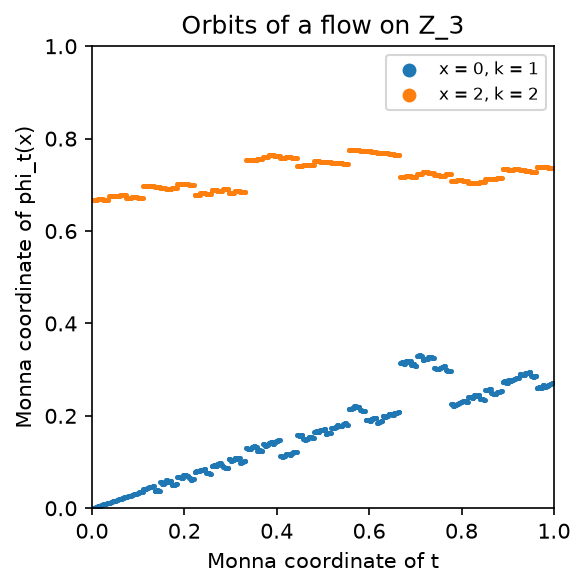
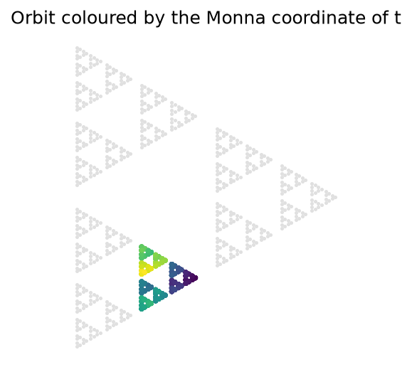
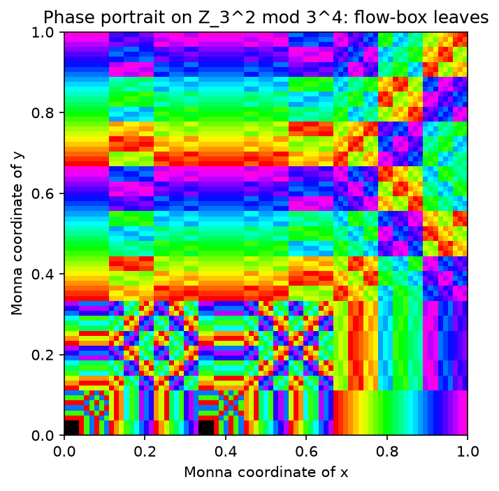
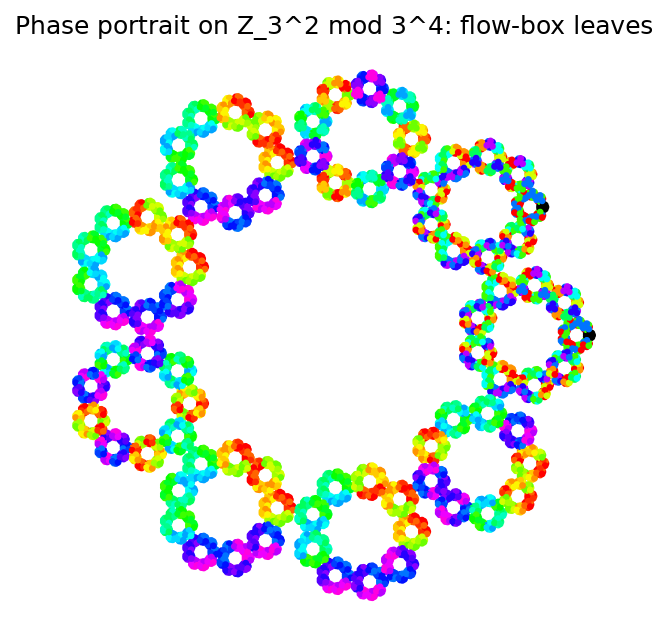
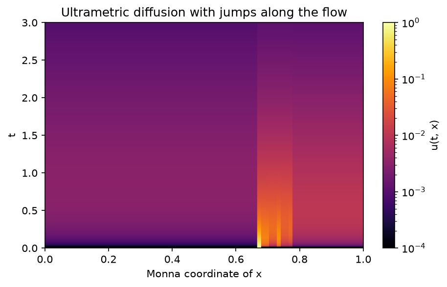
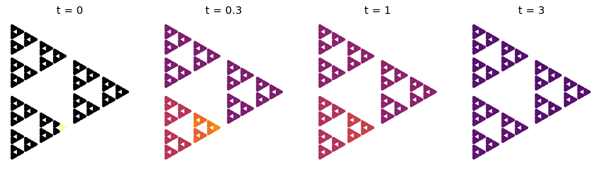
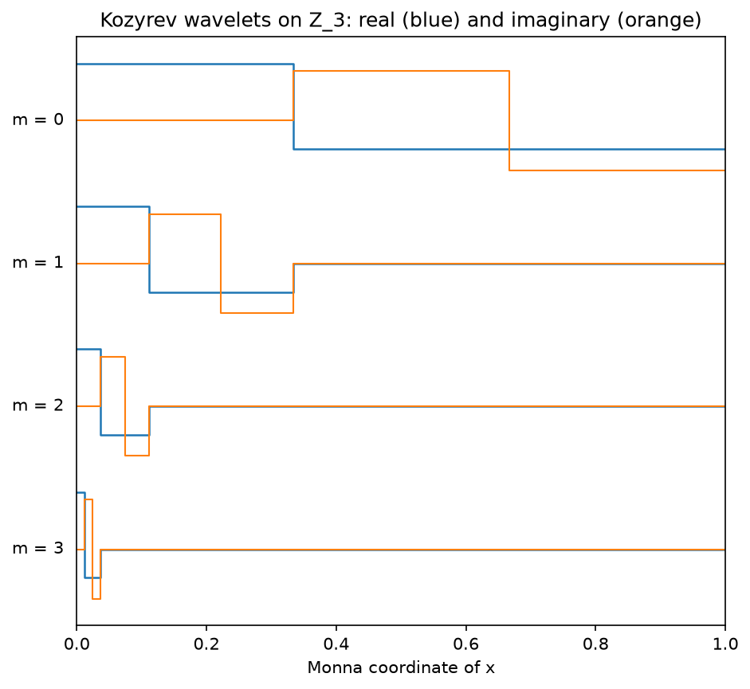
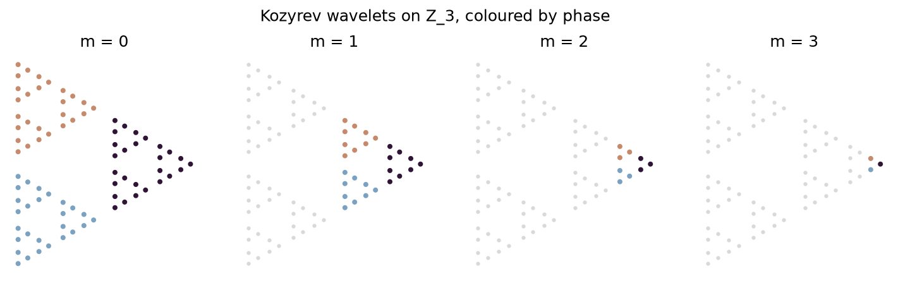

<h1 align='center'>Galrax</h1>
<h2 align='center'>Differential equations on finite groups, in JAX.</h2>

Galrax solves differential equations whose unknown is a function on a finite group,

$$\frac{dp}{dt} = \lambda * p + p * \mu + N(t, p), \qquad p : G \to \mathbb{C},$$

where $*$ is the group convolution $(f * h)(x) = \sum_y f(y)\, h(y^{-1}x)$ and $N$ is any nonlinearity. Examples are heat equations and random walks on Cayley graphs, reaction–diffusion on groups, and nonlinear Schrödinger equations on groups.

On top of it, `diffrax.ultrametric` solves **diffusion on the $p$-adic integers** $\mathbb{Z}_p$: the $p$-adic heat equation $\partial_t u + D^\alpha u = 0$ with the Vladimirov operator, general ultrametric random walks, and their reaction–diffusion versions.

`diffrax.padic_flow` solves **differential equations whose state is $p$-adic**, $dx/dt = f(x)$ or $f(t, x)$ with $x \in \mathbb{Z}_p^d$ and $p$-adic time. The solution is exact to a chosen number of digits, for all initial points and all times at once. It also computes:

- rectifying coordinates, hitting and return times, and orbit averages;
- events, equilibria and linearisations;
- the cycle structure of discrete maps $x \mapsto T(x)$.

The flows run in `int64` JAX arrays.

It is a fork of [Diffrax](https://github.com/patrick-kidger/diffrax): all of Diffrax is included unchanged, and the new functionality lives in `diffrax.group_algebra`, `diffrax.ultrametric` and `diffrax.padic_flow`.

## Features

- **Any finite group**, given by its Cayley table, or generated by permutations.
- **Representation theory computed for you**: conjugacy classes, the character table (Burnside's algorithm), Frobenius–Schur indicators, and unitary irreducible representations (Dixon's method).
- **Fourier transforms on the group**: a direct one, and a **fast** one along a chain of subgroups (separation of variables of Beth, Clausen, Maslen and Rockmore) that works for every group. Both are JAX functions: `jit`, `vmap` and `grad` work.
- **Exact linear part**: in Fourier space the equation splits into small blocks $dX/dt = AX + XB + \hat N$, and the linear flow is $e^{\tau A} X e^{\tau B}$. The `Lawson` solver turns any explicit Runge–Kutta method of Diffrax (`Tsit5`, `Dopri5`, `Bosh3`, ...) into an integrating-factor method that integrates the convolution part exactly, so stiff convolutions do not limit the step size.
- **Every Diffrax solver works too**, either on the Fourier coordinates or directly on the values on the group, with adaptive step sizes, dense output, `SaveAt`, adjoints and the rest of Diffrax.

## Installation

```bash
pip install git+https://github.com/NotTruecCoder/galrax.git
```

Requires Python 3.11+ and JAX. The package installs as `diffrax`, so do not install it next to the upstream `diffrax`.

## Quick example

The heat equation on the Cayley graph of the symmetric group $S_4$, followed by a nonlinear problem solved with the Lawson version of `Tsit5`.

```python
import diffrax
import jax
import jax.numpy as jnp
import numpy as np
import diffrax.group_algebra as ga

jax.config.update("jax_enable_x64", True)

# S_4, generated by a transposition and a 4-cycle (elements 1 and 2).
group = ga.Group.from_permutations([(1, 0, 2, 3), (1, 2, 3, 0)])
print(group.degrees())  # [1 1 2 3 3]

# Heat equation dp/dt = p * u_S - p: it converges to the uniform distribution.
y0 = np.zeros(group.n)
y0[group.ed] = 1.0
heat = ga.GroupODE.heat_equation(group, generators=[1, 2], y0=y0, t0=0.0, t1=50.0)
ys = ga.exact_linear_solution(heat, ts=[0.0, 1.0, 50.0])
print(ys[-1])  # ≈ 1/24 everywhere

# A nonlinear problem: dp/dt = p * mu - p^3.
mu = np.zeros(group.n)
mu[[1, 2]] = 1.0
mu[group.ed] = -2.0
problem = ga.GroupODE(
    group, y0, t0=0.0, t1=10.0, right_kernel=mu,
    nonlinearity=lambda t, p, args: -p**3,
)
solution = ga.solve_group_ode(problem, ga.Lawson(diffrax.Tsit5()), ts=jnp.linspace(0, 10, 11))
print(solution.ys.shape)  # (11, 24)
```

## How it works

1. **Group.** `Group(table)` takes the Cayley table `table[i, j] = index of g_i g_j`. It computes the conjugacy classes, the character table and the unitary irreducible representations $\rho$ once, with NumPy.
2. **Fourier transform.** $\hat f(\rho) = \sum_g f(g)\,\rho(g)$ is a $d_\rho \times d_\rho$ matrix, and convolutions become products: $\widehat{f * h}(\rho) = \hat f(\rho)\,\hat h(\rho)$. `FourierTransform` computes this directly in $O(|G|^2)$. `FastFourierTransform` recurses along a chain of subgroups $\{e\} = G_0 < \dots < G_m = G$, in a basis where every representation of $G_i$ restricted to $G_{i-1}$ is block diagonal.
3. **Solving.** In the coordinates $X_\rho = \sqrt{d_\rho / |G|}\,\hat p(\rho)$ (split into real and imaginary parts, so the transform is an isometry and the state is real) the equation is $dX_\rho/dt = A_\rho X_\rho + X_\rho B_\rho + \hat N_\rho$ with $A = \hat\lambda(\rho)$ and $B = \hat\mu(\rho)$. `Lawson` steps

$$U_i = e^{c_i h L} X_n + h \sum_j a_{ij} e^{(c_i - c_j) h L} N(U_j), \qquad X_{n+1} = e^{hL} X_n + h \sum_i b_i e^{(1 - c_i) h L} N(U_i),$$

with $e^{\tau L} X = e^{\tau A} X e^{\tau B}$ and the Butcher tableau of the wrapped Diffrax solver.

## Diffusion on the p-adic integers

An ultrametric diffusion operator on $\mathbb{Z}_p$ moves mass between points according to their $p$-adic distance:

$$(Lf)(x) = \int_{\mathbb{Z}_p} w(|x - y|_p)\,\bigl(f(y) - f(x)\bigr)\,dy - a f(x).$$

The Vladimirov operator, the $p$-adic analogue of the fractional Laplacian, is the case $w(r) \propto r^{-\alpha - 1}$. These operators model relaxation in hierarchical energy landscapes (Avetisov, Bikulov, Kozyrev), such as glasses and protein dynamics.

Two facts make them easy to compute with, and the module is built on them:

1. **No discretisation error.** Seen from a point $x$, every ball of radius $p^{-n}$ other than its own lies at a single distance. So $L$ maps functions that are constant on such balls to functions of the same kind. These are functions on the cyclic group $\mathbb{Z}/p^n$, where $L$ is exactly a convolution with a radial kernel. The equation is therefore a `GroupODE`, and all of `diffrax.group_algebra` applies.
2. **Kozyrev wavelets diagonalise it.** The wavelets $\psi_{m,a,j}(x) = p^{m/2} e^{2\pi i j (x - a)/p^{m+1}} \mathbf{1}_{a + p^m\mathbb{Z}_p}(x)$ are eigenfunctions, with an eigenvalue that depends only on the level $m$. For $D^\alpha$ it is $p^{\alpha(m+1)}$. `KozyrevTransform` computes the expansion in $O(p^n)$ operations: one FFT of size $p$ per ball. It plugs into `solve_group_ode` as the coordinates for `Lawson`, so the stiff diffusion is integrated exactly while the reaction term is integrated by Runge–Kutta.

```python
import jax
import jax.numpy as jnp
import diffrax.group_algebra as ga
import diffrax.ultrametric as um

jax.config.update("jax_enable_x64", True)

# Z_3 known to 6 digits: 729 balls of radius 3^-6.
Z = um.PAdicIntegers(p=3, n=6)

# L = -D^alpha, for a walk that is killed when it jumps out of Z_3.
L = um.UltrametricOperator.vladimirov(Z, alpha=1.0)
print(-L.eigenvalues[:4])  # [0.75 3. 9. 27.]: the killing rate, then 3^(m+1)

# The p-adic heat equation du/dt + D^alpha u = 0, from a uniform density on 1 + 27 Z_3.
ball = Z.ball(center=1, level=3)
u0 = ball / Z.integrate(ball.astype(float))
u = L.evolve(u0, t=2.0)
print(Z.integrate(u))  # survival probability e^{-0.75 t} = 0.2231

# Reaction-diffusion du/dt = -D^alpha u + 5 u (1 - u), solved in Kozyrev wavelets.
problem = L.problem(
    0.1 * u0 / u0.max(), t0=0.0, t1=5.0,
    nonlinearity=lambda t, u, args: 5.0 * u * (1 - u),
)
solution = ga.solve_group_ode(problem, transform=um.KozyrevTransform(Z), ts=jnp.linspace(0, 5, 6))
print(solution.ys[-1].min(), solution.ys[-1].max())  # 0.85 0.85: 5 (1 - u) = 0.75
```

## Exact flows of p-adic differential equations

Take $dx/dt = f(x)$ with a state $x \in \mathbb{Z}_p^d$. A path $\mathbb{R} \to \mathbb{Z}_p$ is constant, because $\mathbb{R}$ is connected and $\mathbb{Z}_p$ is totally disconnected. Time is therefore $p$-adic as well: $t \in \mathbb{Z}_p$. Let $f$ be a polynomial with coefficients divisible by $p$ (by $4$ when $p = 2$). Then, with $D = f \cdot \nabla$:

- $D^n x$ is divisible by $p^n$, so the Lie series $\varphi_t(x) = \sum_n t^n D^n x / n!$ converges for every $t$ and $x$.
- Modulo $p^K$, the series is a polynomial in $(t, x)$ with integer coefficients.

`PAdicFlow` builds that polynomial once, exactly, and then answers queries with no time stepping and no rounding.

- **Exact flow for any $(t, x)$** with two polynomial evaluations. Write $t = t_{lo} + \sigma$ with $t_{lo} < p^J$. Then $\varphi_t = \varphi_\sigma \circ \varphi_{t_{lo}}$, where $\varphi_{t_{lo}}$ comes from a table of $p^J$ polynomials. The time $\sigma$ is $p$-adically small, so $\varphi_\sigma$ needs only a few Lie terms. This is the way table-driven `exp` is computed. The full series (`method="taylor"`) gives bit-identical results.
- **Low degree by space reduction.** Write $x = a + p^r y$ with $a$ running over the $p^{rd}$ balls of radius $p^{-r}$. Re-expanded around $a$, the term of degree $e$ in $y$ gains the factor $p^{r e}$, so modulo $p^K$ the table polynomials have degree below $K / r$ instead of about $K$. The largest $r$ whose table fits `table_size` entries is chosen; for 19 digits of $\mathbb{Z}_3$ the degree drops from 33 to 2.
- **Every query is independent**, so batches of millions of times and points run in one call under `jit`. Each point reads its row of the table inside Horner's loop, one coefficient at a time, so no per-point copy of the coefficients is made.
- **Flow-box coordinates by short flows.** Newton's correction at step $j$ is divisible by $p^{2^j - 1}$, so after the first steps it is undone with the few-term Lie series of a small time instead of a full flow.
- **Mahler interpolation.** The iterates of $\varphi_1$ determine the flow at every $p$-adic time: $\varphi_t(x) = \sum_n \binom{t}{n} \Delta^n(x)$ with $\Delta^n(x)$ divisible by $p^n$.
- **Orbits are balls.** In one dimension, the orbit $\{\varphi_t(x) : t \in \mathbb{Z}_p\}$ of a non-equilibrium point is the whole ball $B(x, |f(x)|_p)$. The map $t \mapsto \varphi_t(x)$ multiplies distances by exactly $|f(x)|_p$. In $d$ dimensions the orbit is a curve with the same property.
- **Flow-box coordinates.** Around $x$, every point of $B(x, |f(x)|_p)$ is written uniquely as $\varphi_s(w)$, with $w$ on a transversal through $x$. In these coordinates the flow is $s \mapsto s + t$. They are computed by Newton's method, which doubles the number of correct digits per step.
- **Exact answers by formula**, from the flow-box coordinates:
  - the first time the orbit enters a ball;
  - return times, $p^{\max(m - k, 0)}$;
  - orbit averages of locally constant functions, from $p^{m-k}$ evaluations instead of a long sum.
- **Koopman operators.** $U u = u \circ \varphi_\tau$ on $(\mathbb{Z}/p^n)^d$, diagonalised by an FFT along each cycle. Combined with `diffrax.ultrametric`, the flow is an isometry that preserves the Haar measure, so $U$ commutes with ultrametric diffusion. Hence $p$-adic advection–diffusion $du/dt = Lu + \kappa(U - I)u$ is solved exactly.
- **More digits.** Up to $p^K < 2^{31}$ products fit in one `int64`. Beyond that, up to about twice as many digits (38 for $p = 3$, 61 for $p = 2$), residues still fit in `int64`. Products are then formed from half-length digits $a = a_0 + B a_1$ with $B^2 \equiv 0$, which takes three machine products. Beyond that there is no limit: residues become $L$ limbs $\sum a_i B^i$ along an extra axis, and since $B^L \equiv 0$ a product needs only the $L(L+1)/2$ limb products with $i + j < L$ and one pass of carries. The mode is selected automatically; results with more than about 62 bits come back as Python integers.
- **Sparse storage in several dimensions.** The Lie polynomials and the reduced tables have bounded total degree, so only the $\binom{\deg + d}{d}$ monomials of the simplex are stored, instead of $(\deg + 1)^d$, and they are evaluated by Horner's rule nested over the simplex, one multiplication per coefficient. The tables are built in the same layout: each variable is shifted to the centres in turn, which keeps the total degree, so no dense array is ever formed. This is the default for $d > 1$.
- **Centres per coordinate.** Each coordinate gets its own number of digits $r_j$ in $x_j = a_j + p^{r_j} y_j$, and a monomial survives while $\sum_j r_j e_j < K$. The default minimises the work per point within `table_size`. A coordinate in which the polynomials are affine gets no centres at all, since reducing it saves nothing. For $dx/dt = t x$ (time-dependent, so the flow is linear in $x$) this gives $r = (6, 0)$ and 297 M/s against 181 M/s with $r = (3, 3)$. For a three-dimensional field with one square term it gives $(0, 3, 2)$ and 142 M/s against 67 M/s. Sorting the points by their row of the table before reading it was also tried. It made the flow 2–3 times slower, because the sort costs more than the coherent reads save.
- **Analytic fields.** A component may be a `PowerSeries` with coefficients tending to zero, such as `3 * PowerSeries.exp(3)` or `3 * PowerSeries.geometric(3)` for $3/(1 - 3x)$. Modulo $p^{K+g}$, with $g$ the guard digits of the Lie series, such a series is a polynomial, so it is cut there and the flow stays exact modulo $p^K$. Series are given by their coefficients and a lower bound on their valuations, and add and multiply with each other and with polynomials.
- **Time-dependent equations** $dx/dt = f(t, x)$, for any $f$ with $p$-adic integer coefficients, from $t_0$ to $t_0 + p\,\mathbb{Z}_p$.
  - Time cannot range over all of $\mathbb{Z}_p$: $dx/dt = p\,t^{p^2 - 1}$ gives $x = x_0 + t^{p^2}/p$, which leaves $\mathbb{Z}_p$.
  - On $t_0 + p\,\mathbb{Z}_p$ the problem becomes autonomous in $(t, x)$, with a field divisible by $p$.
- **Events**, in the spirit of `diffrax.Event`: the condition $g(\varphi_t(x)) = 0$ (to a chosen number of digits) for polynomials $g$.
  - $p$-adic time has no order, so the result is the whole set of times, a finite union of balls in $\mathbb{Z}_p$, from which the first integer time is read off.
  - $t \mapsto g(\varphi_t(x))$ is a power series known exactly. Balls in time are refined digit by digit using its Taylor expansion, and Strassmann's theorem bounds the number of exact zeros.
- **Equilibria and linearisation.**
  - All zeros of $f$ in $\mathbb{Z}_p^d$ are found by the same refinement in space. Simple zeros are certified by Hensel's lemma.
  - Around a simple equilibrium in one dimension, the Poincaré–Siegel coordinate $h$ satisfies $h(\varphi_t(x)) = e^{\lambda t} h(x)$.
  - $h$ is computed with a proved convergence radius and tail bound. It gives the flow, and orbit times via the $p$-adic logarithm, independently of the Lie series.
  - In any dimension, `normal_form` gives the Poincaré–Dulac normal form $dz/dt = Az + R(z)$ in coordinates $x = x^* + p^r \Phi(z)$, where $R$ keeps only the terms that cannot be removed. Each degree solves the homological equation through the Smith normal form of its matrix over $\mathbb{Z}_p$. Its elementary divisors are the small divisors $\langle m, \lambda \rangle - \lambda_i$, found without computing the eigenvalues. One algorithm therefore covers complex pairs (eigenvalues in an extension of $\mathbb{Q}_p$), Jordan blocks, resonances, zero eigenvalues and near-resonances. Keeping a removable term in $R$ never breaks the conjugacy, so the flow through the normal form is exact either way.
- **Discrete maps.** `PAdicMap` handles a polynomial or any 1-Lipschitz function, such as a T-function.
  - It builds the tree of cycles on $\mathbb{Z}/p^k$: each cycle grows, splits, partially splits or grows tails, through the map it induces on the $p$ balls above it.
  - It returns the minimal decomposition and decides minimality (ergodicity).
  - For polynomials, growth is permanent beyond the level given by Desjardins–Zieve and Fan–Liao, so minimal components are recognised exactly.

```python
flow = pf.PAdicFlow(p=3, precision=38, field=[0, -3, 0, 3])  # 38 digits, "double" products

event = pf.PAdicEvent({(1,): 1, (0,): -29}, depth=4)  # phi_t(2) = 29 mod 3^4
times = flow.event_times(event, 2)
print(times.balls, times.first())  # [Ball(center=(6,), level=2)] 6: every t = 6 mod 9

lin = flow.linearization(flow.equilibria()[2])  # around x* = -1
x = (lin.equilibrium + 15) % 3**38
print(lin.flow_map(12345, x) == int(flow.flow(12345, x)))  # True

growth = pf.TimeDependentFlow(3, 19, [{(1, 1): 1}])  # dx/dt = t x
print(growth.flow(1, 22, 5))  # x(22) from x(1) = 5

doubling = pf.PAdicMap(5, [0, 2])  # x -> 2x on Z_5
print(doubling.minimal_decomposition(4))  # the spheres |x| = 5^-k are minimal; 0 is fixed
print(pf.PAdicMap(2, lambda x: x + (x * x | 5)).is_minimal(16))  # Klimov-Shamir: True
```

```python
import jax
import numpy as np
import diffrax.padic_flow as pf

jax.config.update("jax_enable_x64", True)

# dx/dt = 3 (x^3 - x) on Z_3, to 19 digits, for all x in Z_3 and all t in Z_3.
flow = pf.PAdicFlow(p=3, precision=19, field=[0, -3, 0, 3])
x = np.array([0, 1, 2, 5])
print(flow.orbit_level(x))  # [19 19 2 2]: equilibria 0 and 1, orbits 2 + 9 Z_3 and 5 + 9 Z_3

y = flow.flow(t=12345, x=x)  # phi_t(x) mod 3^19, exact
print(np.array_equal(flow.flow(-12345, y), x))  # True

time, on_orbit = flow.orbit_time(2, y[2])  # rectifying coordinate, by Newton's method
print(int(time) % 3**17, on_orbit)  # 12345 True

print(flow.first_hitting_time(2, 29, level=4))  # first n with phi_n(2) = 29 mod 3^4: 6
print(flow.return_time(2, level=10))  # 3^(10 - 2) = 6561

# The plane: dx/dt = 3 y, dy/dt = -3 x + 3 x^2.
plane = pf.PAdicFlow(3, 12, [{(0, 1): 3}, {(1, 0): -3, (2, 0): 3}])
z = plane.flow(100, np.array([1, 2]))
s, foot = plane.rectify(np.array([1, 2]), z)  # s = 100, foot = [1, 2]
```

Throughput for $10^6$ random $(t, x)$ per call under `jit`, on a laptop GPU with 6 GB of memory (JAX 0.12 with CUDA 12, in WSL2): the median of 20 calls after 5 warm-up calls. The results are exact; every method agrees bit for bit. "Before" is the version without space reduction, gathered Horner and short Newton flows; for $d = 2$ it is the current code with `space_digits=0`.

| $p$, digits, $d$ | Degree before → after | `flow` before → after | `rectify` before → after |
|---|---|---|---|
| 3, 19, 1 | 33 → 2 | 71 → 215 M/s | 9.7 → 41 M/s |
| 5, 13, 1 | 13 → 2 | 125 → 199 M/s | 19 → 48 M/s |
| 7, 11, 1 | 11 → 2 | 124 → 196 M/s | 17 → 49 M/s |
| 3, 38, 1 (two-word) | 75 → 5 | 23 → 67 M/s | 2.8 → 14 M/s |
| 3, 12, 2 | 12 → 3 | 19 → 187 M/s | 6.1 → 29 M/s |
| 3, 8, 3 | 5 (dense → sparse) | 11 → 200 M/s | 3.3 → 11 M/s |

In two and three dimensions most of the gain is sparse storage: with the same tables stored densely, the plane runs at 42 M/s and the three-dimensional case at 11 M/s. With limbs, 60 digits of $\mathbb{Z}_3$ run at 2.9 M/s, 100 digits at 0.5 M/s, and 100 digits of $\mathbb{Z}_2$ at 2.7 M/s. At 38 digits limbs are 3.6 times slower than two-word products (18 against 66 M/s), so two-word products are used up to $2^{62}$.

The full Lie series (`method="taylor"`) runs at 2–60 M/s on the same GPU. On the laptop's CPU (batch $10^5$) the same cases run at 0.7–5.8 M/s for `flow`, 2.3–3.3 times faster than without space reduction, so the GPU is 35–70 times faster. The plain `int64` remainder was the fastest reduction on the GPU and on the CPU under Linux, and is the default; Barrett reduction was faster only with a native Windows build of JAX, and a `float32` quotient estimate (`"barrett32"`) does not help. Tables of 0.5–10 MB are the fastest; larger ones fall out of cache, which is why `table_size` defaults to $2^{20}$ entries.

## Pictures of p-adic dynamics

$\mathbb{Z}_p$ is drawn in two ways. The **Monna map** $\sum a_k p^k \mapsto \sum a_k p^{-k-1}$ sends it onto $[0, 1]$, with balls becoming intervals. The **fractal embedding** $\sum a_k p^k \mapsto \sum \omega^{a_k} \rho^k$, with $\omega = e^{2\pi i/p}$, sends it into the plane, with balls becoming nested clusters (a Sierpinski triangle for $p = 3$). `examples/padic_figures.py` draws all of the figures below.

| | |
|---|---|
|  |  |
| The graph of $t \mapsto \varphi_t(x)$ for $dx/dt = 3 - 3x + 6x^3$, both axes in Monna coordinates. The orbit of $0$ fills a band of height $1/3$, and that of $2$ a band of height $1/9$: $t \mapsto \varphi_t(x)$ is a similarity of ratio $\lvert f(x) \rvert_3$. | The orbit of $2$ on the fractal picture of $\mathbb{Z}/3^6$, coloured by time: a whole sub-triangle, that is, a ball. |
|  |  |
| The phase portrait of $dx/dt = 3y$, $dy/dt = -3x + 3x^2$ on $\mathbb{Z}_3^2$. Each point is coloured by the leaf of the flow-box foliation through it, so orbits are the sets of one colour; the equilibria $(0, 0)$ and $(1, 0)$ are black. | The same on the fractal picture of $\mathbb{Z}_3^2$. |
|  |  |
| $du/dt = -D^{1/2} u + 2(U - I) u$ from the indicator of a small ball: the jumps along the flow move the mass across its orbit ball, and diffusion spreads it over $\mathbb{Z}_3$ (logarithmic colour scale). | The same at four times. |
|  |  |
| The Kozyrev wavelets $\psi_{m,0,1}$, one per level, as step functions on $[0, 1]$. | The same, coloured by phase; each lives on a ball of radius $3^{-m}$. |

`plot_phase_portrait(flow, level, colour="speed")` colours by $v_p(f(x))$ instead, the scale of the orbit through $x$.

## API

The following live in `diffrax.group_algebra`.

| Name | What it is |
|---|---|
| `Group` | A finite group from its Cayley table; `Group.cyclic(n)`, `Group.from_permutations(generators)`. Classes, characters, irreducible representations. |
| `subgroup_chain`, `subgroup_closure` | Chains of subgroups for the fast transform. |
| `FourierTransform`, `FastFourierTransform` | Fourier transforms on the group: `forward`, `inverse`, `convolve`, `to_coordinates`, `from_coordinates`. |
| `convolution` | Direct convolution on the group. |
| `GroupODE` | The problem: group, initial condition, time interval, kernels, nonlinearity. `GroupODE.heat_equation(...)`. |
| `exact_linear_solution` | The exact solution of a linear problem. |
| `Lawson` | Integrating-factor version of an explicit Diffrax Runge–Kutta solver. |
| `solve_group_ode` | Solve a `GroupODE` with any Diffrax solver; returns a `GroupSolution`. |
| `fourier_terms`, `fourier_term`, `physical_term` | The Diffrax terms, for calling `diffrax.diffeqsolve` yourself (for example to differentiate through the solve). |
| `AbstractSpectralTransform` | Base class for coordinates in which the linear part is exponentiated exactly; implemented by the Fourier transforms and by `KozyrevTransform`. |
| `AbstractExponentialTerm`, `FourierLinearTerm`, `DiagonalLinearTerm` | Linear terms with an exact flow, as used by `Lawson`. |

The following live in `diffrax.ultrametric`.

| Name | What it is |
|---|---|
| `PAdicIntegers(p, n)` | $\mathbb{Z}_p$ known to $n$ digits: digits, valuations, $p$-adic norms and distances, balls, Haar integrals, rationals as $p$-adic integers. |
| `UltrametricOperator` | $L$ from its rates $w(p^{-k})$ and absorption $a$; `vladimirov(integers, alpha)`, `from_function`. Applies in $O(n p^n)$, exposes the kernel and the eigenvalues, evolves exactly with `evolve`, and builds a `GroupODE` with `problem`. |
| `monna`, `fractal_embedding`, `plot_kozyrev_wavelets` | $\mathbb{Z}_p$ on the line and in the plane, and pictures of the wavelets (needs matplotlib). |
| `KozyrevTransform` | The Kozyrev wavelet expansion: `forward`, `inverse`, `basis`, `spectrum` of radial kernels; usable as the `transform` of `solve_group_ode`. |

The following live in `diffrax.padic_flow`.

| Name | What it is |
|---|---|
| `PAdicFlow(p, precision, field)` | The flow of a polynomial field divisible by $p$. Options: `table_digits`, `space_digits` (default: the largest that fits `table_size`), `reduction`, `storage` (`"dense"` or `"sparse"`). `flow(t, x)` (`"table"` or `"taylor"`), `vector_field`, `mahler_coefficients`, `orbit_level`, `rectify` (flow-box coordinates), `orbit_time`, `first_hitting_time`, `return_time`, `orbit_average`, `event_times`, `first_event`, `equilibria`, `jacobian`, `linearization`. |
| `TimeDependentFlow(p, precision, field)` | $dx/dt = f(t, x)$ from $t_0$ to $t_1 \in t_0 + p\,\mathbb{Z}_p$; the underlying autonomous flow in $(t, x)$ is `autonomous`. |
| `PAdicEvent(condition, depth)`, `EventSet` | An event $g(\varphi_t(x)) = 0$ and its set of times: `balls`, `first()`, `measure()`, `zero_bound`, membership. |
| `Equilibrium`, `Linearization` | Zeros of $f$ (with Hensel certificates), and linearising coordinates for $d = 1$: `forward`, `inverse`, `flow_map`, `orbit_time`. |
| `NormalForm(flow, equilibrium)` | The Poincaré–Dulac normal form in any dimension: `normal_form`, `resonant_terms`, `linearizable`, `divisors`, `radius`, `forward`, `inverse`, `flow_map`, `exponential`. |
| `PAdicMap(p, map)`, `Cycle`, `Component` | Discrete maps: `cycle_tree`, `cycles(level)`, `minimal_decomposition`, `is_minimal`, `is_bijective`. |
| `KoopmanOperator(flow, level, time=1)` | $u \mapsto u \circ \varphi_\tau$ on $(\mathbb{Z}/p^n)^d$: its cycles, and `evolve_jumps`, which computes $e^{t\kappa(U - I)}$ by an FFT along each cycle. |
| `advection_diffusion(koopman, operator, u0, t, rate)` | The exact solution of $du/dt = Lu + \kappa(U - I)u$, with $L$ an `UltrametricOperator`. |
| `plot_trajectory`, `plot_phase_portrait`, `plot_advection_diffusion` | Pictures of orbits, phase portraits and advection–diffusion, in Monna coordinates or on the fractal picture (needs matplotlib). |
| `Residues(p, precision, reduction)` | Arithmetic in $\mathbb{Z}/p^K$ on `int64` arrays: products reduced by `"barrett"`, `"barrett32"`, `"remainder"` or `"double"` (two-word); valuations, unit inverses by Newton's method, exact division. The default is the plain remainder. |
| `PowerSeries(coefficient, bound, dimension)` | An analytic field component; `exp`, `log1p`, `geometric`, `polynomial`, `variable`, sums and products. |
| `Limbs(p, precision)` | The same for any number of digits, with residues stored as `int64` limbs along a trailing axis; `decode` returns Python integers. |

## Notes and limitations

- Enable 64-bit precision (`jax.config.update("jax_enable_x64", True)`) for accurate results; the representations are computed in `float64`.
- Computing the representations costs about $O(|G|^3)$, so groups up to a few thousand elements are practical. The fast transform also needs the representations of every subgroup in its chain.
- `Lawson` has linear dense output between steps.
- The nonlinearity must be a JAX function. For a real problem (real `y0` and kernels) it must map real arrays to real arrays.
- On $\mathbb{Z}/p^n$, `UltrametricOperator` and `KozyrevTransform` are $O(n p^n)$ and work for millions of points. A `GroupODE`, however, needs the `Group`, which stores a Cayley table of $p^{2n}$ entries. Solving with `solve_group_ode` is therefore limited to a few thousand points. `KozyrevTransform` never computes representations, and its coordinates are a single array rather than one block per representation, so it also compiles much faster than `FourierTransform` on these groups.
- Kozyrev coefficients are complex, so a real problem is solved in $2p^n$ real coordinates.
- The flows need 64-bit JAX (`jax_enable_x64`).
- On Windows, JAX uses the GPU only under WSL2 (`pip install "jax[cuda12]"`). Set `XLA_PYTHON_CLIENT_PREALLOCATE=false` there, since part of the GPU memory is held by Windows.
- On a laptop GPU the clock changes under load. Time with warm-up calls and a median, or single runs can differ by a factor of 3.
- Up to $p^K < 2^{31}$ (30, 19, 13 and 11 digits for $p = 2, 3, 5, 7$) one product is one machine multiplication; up to $2^{62}$ (61, 38, 26 and 22 digits) it is three; beyond that, with $L$ limbs, $L(L+1)/2$. Beyond $2^{62}$ queries return arrays of Python integers, so they cannot be traced by `jit` as a whole; the device work is still batched.
- Events, equilibria, linearisation and maps run on the host with exact Python integers. They are built from the device-side flow, but each search is sequential.
- In higher dimension the normal form converges on a ball $\lvert x - x^* \rvert \le p^{-r}$ whose radius depends on the small divisors (compare Herman–Yoccoz). The radius is the smallest one for which every division is exact and the coefficients decay. The series are cut where the observed decay passes $p^{-K}$; this is checked numerically, not proved. Divisors above `resonance_digits` (default $K/2$) are kept in $R$; with Jordan blocks the elementary divisors add up along each chain, so a larger threshold is needed to linearise.
- Fields must be polynomials or power series converging on $\mathbb{Z}_p^d$, with coefficients divisible by $p$ (by $4$ for $p = 2$); scaling time by $p$ reduces the general case to this one. In several dimensions memory grows like $\binom{\deg + d}{d}$ per polynomial and the number of centres like $p^{rd}$, so the space reduction gets coarser as $d$ grows; the tests go up to $d = 4$.
- On what is known: interpolating iterates by Mahler series is due to Bell and Poonen. The behaviour of cycles of polynomial maps (grows, splits, ...) and the permanence of growth are due to Desjardins–Zieve and Fan–Liao. Convergence of one-dimensional $p$-adic linearisation is due to Herman–Yoccoz.
- "Orbits of a flow are balls $B(x, |f(x)|_p)$ with a similarity parametrisation" follows from the bound $|D^n x / n!| < |f(x)|$. It can also be read off Fan–Liao applied to the time-one map, and we found no separate statement of it.
- As far as we could find, the computational side is not in the literature: exact global flows in machine integers by table and Lie series, flow-box coordinates by Newton's method, event sets by ball refinement, and the Koopman and diffusion coupling.

## Development

```bash
git clone https://github.com/NotTruecCoder/galrax.git
cd galrax
pip install -e . pytest scipy beartype
pytest test/test_group_algebra.py test/test_ultrametric.py test/test_padic_flow.py
```

The full Diffrax test suite also runs with `pytest`.

## Credits and license

Galrax is built on [Diffrax](https://github.com/patrick-kidger/diffrax) by Patrick Kidger, and is distributed under the same [Apache 2.0 license](LICENSE). If you use the Diffrax part in academic work, please cite:

```bibtex
@phdthesis{kidger2021on,
    title={{O}n {N}eural {D}ifferential {E}quations},
    author={Patrick Kidger},
    year={2021},
    school={University of Oxford},
}
```

References for the methods: W. Burnside and J. D. Dixon (character tables and representations), M. Clausen, D. Maslen and D. Rockmore (fast Fourier transforms on finite groups), J. D. Lawson (integrating factor Runge–Kutta methods, 1967), V. S. Vladimirov, I. V. Volovich and E. I. Zelenov (*p-adic Analysis and Mathematical Physics*, 1994), S. V. Kozyrev (*Wavelet theory as p-adic spectral analysis*, 2002), V. A. Avetisov, A. H. Bikulov and S. V. Kozyrev (ultrametric diffusion and hierarchical landscapes, 1999), K. Mahler (interpolation of continuous functions on $\mathbb{Z}_p$, 1958), J. P. Bell and B. Poonen ($p$-adic interpolation of iterates), A. Fan and L. Liao (minimal subsystems of polynomial dynamics on $\mathbb{Z}_p$), V. Anashin and A. Khrennikov (*Applied Algebraic Dynamics*, 2009), P. Barrett (modular reduction, 1986), P. T. P. Tang (table-driven elementary functions, 1989), R. Strassmann (zeros of $p$-adic power series, 1928), M.-R. Herman and J.-C. Yoccoz (linearisation over non-archimedean fields, 1983), B. Desjardins and M. Zieve (cycles of polynomial maps on $\mathbb{Z}_p$), M. V. Larin (transitive polynomials, 2002), A. Klimov and A. Shamir (T-functions, 2002).
