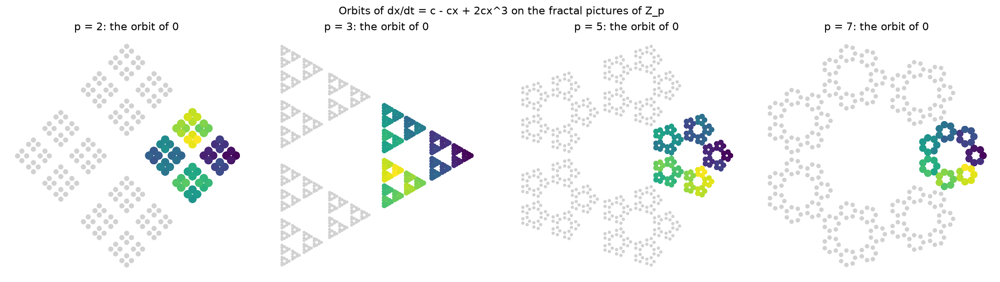
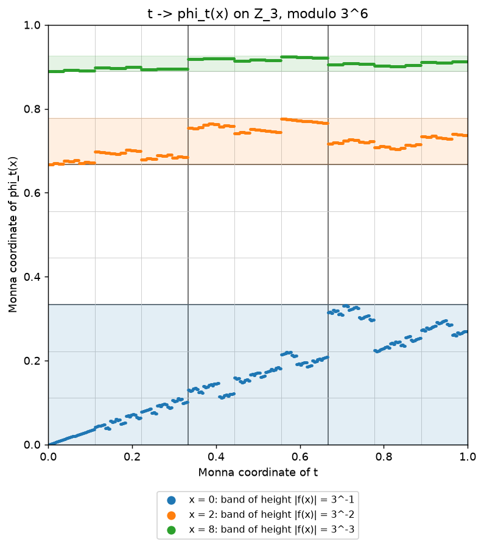
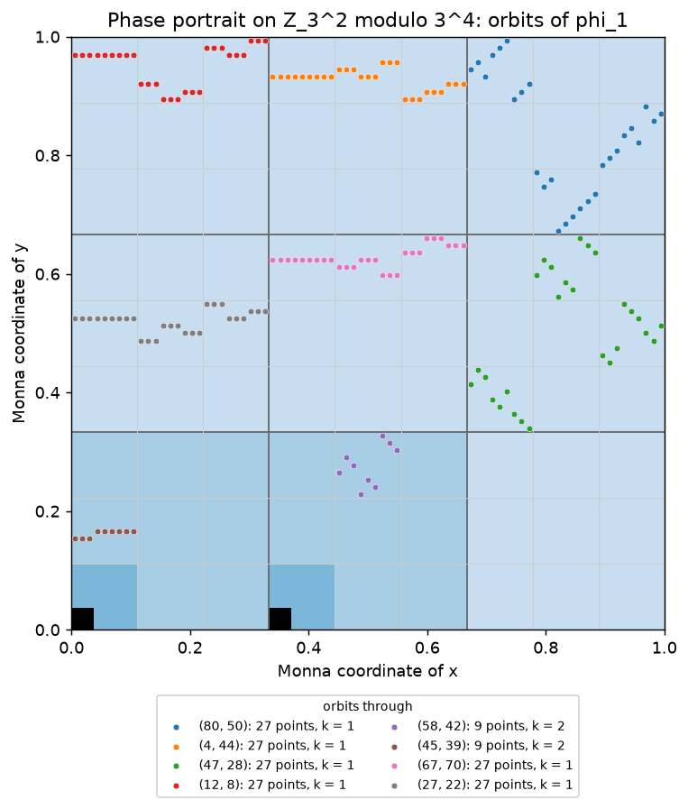
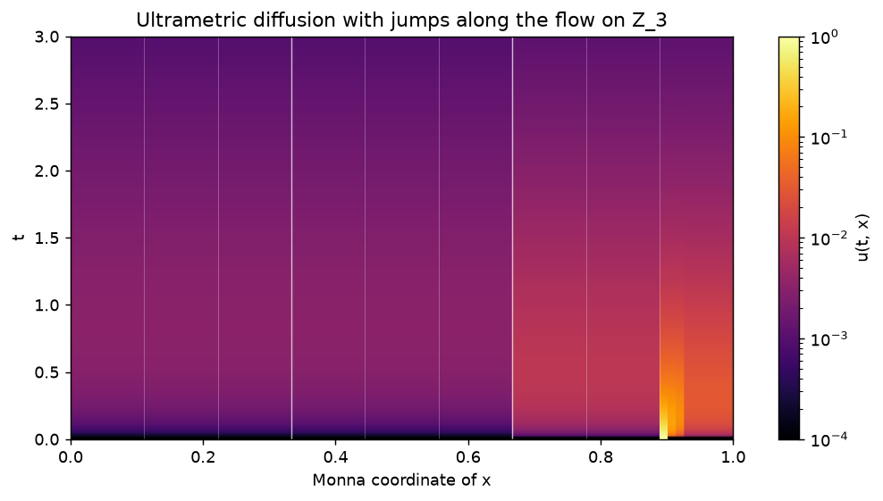
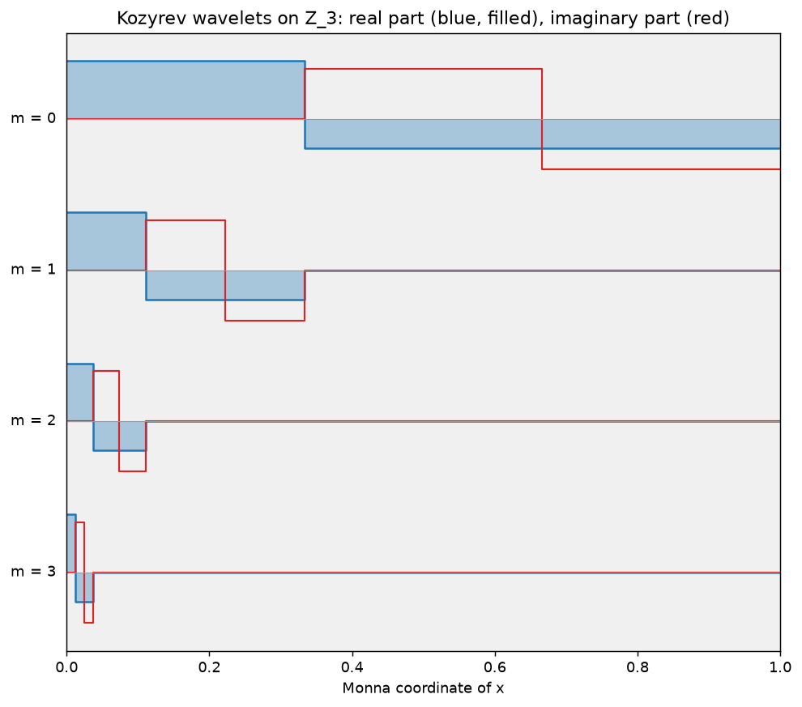

<h1 align='center'>Galrax</h1>
<h2 align='center'>Differential equations on finite groups and over the p-adic numbers, in JAX.</h2>

Galrax is a fork of [Diffrax](https://github.com/patrick-kidger/diffrax) that adds three things Diffrax was never meant to do:

- **`diffrax.group_algebra`**: differential equations whose unknown is a function on a finite group, such as heat equations on Cayley graphs or reaction–diffusion on a group.
- **`diffrax.ultrametric`**: diffusion on the $p$-adic integers $\mathbb{Z}_p$, solved with no discretisation error.
- **`diffrax.padic_flow`**: differential equations whose *state* is $p$-adic, $dx/dt = f(x)$ with $x \in \mathbb{Z}_p^d$. These can be solved exactly, for every starting point and every time at once, and that is the main subject of this repository.

All of Diffrax is included unchanged.

## Why p-adic flows can be solved exactly

Over the real numbers, solving $dx/dt = f(x)$ means approximating: every step makes an error, and the error grows. Over the $p$-adic integers the picture is different. If the coefficients of $f$ are divisible by $p$ (by $4$ when $p = 2$), the Lie series

$$\varphi_t(x) = \sum_{n \ge 0} \frac{t^n}{n!} D^n x, \qquad D = f \cdot \nabla,$$

converges for every $x \in \mathbb{Z}_p^d$ and every $p$-adic time $t \in \mathbb{Z}_p$, and modulo $p^K$ it is a polynomial in $(t, x)$ with integer coefficients. So "the flow to $K$ digits" is a finite object that can be computed exactly, with no rounding at all. Time has to be $p$-adic, by the way: a continuous path from $\mathbb{R}$ into $\mathbb{Z}_p$ is constant.

The hard part is speed: the polynomial has degree about $K$. Most of `diffrax.padic_flow` is about making it small, and about using the exactness to answer questions that are usually numerical.

What it can do:

- **Evaluate the flow exactly on the GPU.** Time is split into a tabulated part and a $p$-adically small part, as in table-driven `exp`, and space is re-expanded around the centres of small balls. For 19 digits of $\mathbb{Z}_3$ the degree drops from 33 to 2, and a laptop GPU computes $2 \times 10^8$ to $6 \times 10^8$ exact values per second, depending on its clock. Any number of digits works, through two-word and multi-limb arithmetic.
- **Describe the orbits.** In one dimension the orbit of $x$ is exactly the ball of radius $|f(x)|_p$ around it, traversed at constant speed. In any dimension there are flow-box coordinates, computed by Newton's method, which give hitting times, return times and orbit averages by formula.
- **Find events, equilibria and linearisations.** Event sets are finite unions of balls in time, found by refinement; equilibria are certified by Hensel's lemma.
- **Interpolate iterates and certify minimal actions.** A map congruent to the identity modulo $p$ is the time-one map of exactly one field, computed from the iterates; several such maps whose displacements at a point form a basis of $p^k\mathbb{Z}_p^d$ generate a group acting minimally on that ball, with an explicit isometric chart.
- **Compute certified normal forms.** Near an equilibrium, the Poincaré–Dulac normal form is built through the Smith form of the homological operator over $\mathbb{Z}_p$. Complex eigenvalues, Jordan blocks, resonances and zero eigenvalues all go through the same algorithm. Each result comes with a certificate, rechecked in exact arithmetic, that the flow through the normal form is exact modulo $p^K$.
- **Compute $p$-adic elliptic logarithms.** The formal logarithm of $\mathbb{G}_m$ or of an elliptic curve is the flow-box coordinate of an explicit field, so the flow machinery computes it exactly, together with multiples $[t]P$ for $p$-adic $t$.
- **Analyse discrete maps.** Cycle trees and minimal decompositions of polynomial and 1-Lipschitz maps of $\mathbb{Z}_p$.

The methods are described in the preprint *Exact flows and normal forms of differential equations over the $p$-adic integers* (K. Terskii, in preparation).

## Installation

```bash
pip install git+https://github.com/NotTruecCoder/galrax.git
```

You need Python 3.11+ and JAX. The package installs as `diffrax`, so do not install it next to the upstream `diffrax`. The $p$-adic code needs 64-bit integers: call `jax.config.update("jax_enable_x64", True)` first.

## Exact p-adic flows

```python
import jax
import numpy as np
import diffrax.padic_flow as pf

jax.config.update("jax_enable_x64", True)

# dx/dt = 3 (x^3 - x) on Z_3, to 19 digits, for all x in Z_3 and all t in Z_3.
flow = pf.PAdicFlow(p=3, precision=19, field=[0, -3, 0, 3])
x = np.array([0, 1, 2, 5])
print(flow.orbit_level(x))  # [19 19 2 2]: equilibria 0 and 1, orbits 2 + 9 Z_3 and 5 + 9 Z_3

y = flow.flow(t=12345, x=x)  # phi_t(x) mod 3^19, exact
print(np.array_equal(flow.flow(-12345, y), x))  # True

time, on_orbit = flow.orbit_time(2, y[2])  # rectifying coordinate, by Newton's method
print(int(time) % 3**17, on_orbit)  # 12345 True

print(flow.first_hitting_time(2, 29, level=4))  # first n with phi_n(2) = 29 mod 3^4: 6
print(flow.return_time(2, level=10))  # 3^(10 - 2) = 6561

# The plane: dx/dt = 3 y, dy/dt = -3 x + 3 x^2.
plane = pf.PAdicFlow(3, 12, [{(0, 1): 3}, {(1, 0): -3, (2, 0): 3}])
z = plane.flow(100, np.array([1, 2]))
s, foot = plane.rectify(np.array([1, 2]), z)  # s = 100, foot = [1, 2]
```

Events, linearisation, time-dependent fields, discrete maps and a certified normal form:

```python
flow = pf.PAdicFlow(p=3, precision=38, field=[0, -3, 0, 3])  # 38 digits, "double" products

event = pf.PAdicEvent({(1,): 1, (0,): -29}, depth=4)  # phi_t(2) = 29 mod 3^4
times = flow.event_times(event, 2)
print(times.balls, times.first())  # [Ball(center=(6,), level=2)] 6: every t = 6 mod 9

lin = flow.linearization(flow.equilibria()[2])  # around x* = -1
x = (lin.equilibrium + 15) % 3**38
print(lin.flow_map(12345, x) == int(flow.flow(12345, x)))  # True

growth = pf.TimeDependentFlow(3, 19, [{(1, 1): 1}])  # dx/dt = t x
print(growth.flow(1, 22, 5))  # x(22) from x(1) = 5

doubling = pf.PAdicMap(5, [0, 2])  # x -> 2x on Z_5
print(doubling.minimal_decomposition(4))  # the spheres |x| = 5^-k are minimal; 0 is fixed
print(pf.PAdicMap(2, lambda x: x + (x * x | 5)).is_minimal(16))  # Klimov-Shamir: True

# x' = 3x + 3y^2, y' = 6y + 3x^2 + 3xy: the resonance 2 * 3 = 6 keeps x^2 in y'.
resonant = pf.PAdicFlow(3, 8, [{(1, 0): 3, (0, 2): 3}, {(0, 1): 6, (2, 0): 3, (1, 1): 3}])
form = resonant.normal_form((0, 0))
print(form.resonant_terms, form.radius)  # [{}, {(2, 0): ...}] 2: on |x| <= 3^-2
print(form.certificate.verify())  # True: the flow through the normal form is exact mod 3^8
```

Maps close to the identity, minimal actions and bounds on small divisors:

```python
from fractions import Fraction

g = [{(1, 0): 1, (0, 0): 3, (0, 2): 3}, {(0, 1): 1, (1, 0): 9}]  # (x + 3 + 3y^2, y + 9x)
h = [{(1, 0): 1, (0, 1): 9}, {(0, 1): 1, (0, 0): 3, (2, 0): 3}]  # (x + 9y, y + 3 + 3x^2)

flow = pf.PAdicFlow.from_time_one(3, 8, g)  # the field X with phi_1 = g
print(flow.flow(-1, flow.flow(1, np.array([4, 7]))))  # [4 7]: phi_{-1} = g^{-1}

action = pf.MinimalAction(3, 8, [g, h], (0, 0))
print(action.level)  # 1: <g, h> acts minimally on (0, 0) + 3 Z_3^2
z = action.chart([5, 7])  # phi^g_5 o phi^h_7 (0, 0), an isometry of Z_3^2 onto the ball
print(action.coordinates(z))  # [5 7]

print(pf.smith_exponent_bound([[3, 3], [0, 3]], n=4, p=3))  # (10, 26): rank, exponent bound
print(pf.linear_degree([10, Fraction(28, 19)], p=3, threshold=12))  # 3: eigenvalues log_3
```

### Elliptic logarithms as flows

For a formal group with invariant differential $\omega(z)\,dz$, the field $f(u) = p/\omega(pu)$ moves points by translation in the group: $\log(p\,\varphi_s(u)) = \log(pu) + p^2 s$. Its rectifying coordinate is the formal logarithm, so Newton's method for flow-box coordinates computes $p$-adic elliptic logarithms exactly. The same idea gives the small divisors of a linear part $\mathrm{diag}(\log P_1, \dots, \log P_d)$: they are logarithms of the points $\sum_j m_j P_j - P_i$, and their valuations come straight from rational arithmetic on the curve.

```python
from fractions import Fraction

E = pf.EllipticCurve((0, 1, 1, -2, 0))  # y^2 + y = x^3 + x^2 - 2x, rank 2
group = pf.FormalGroupFlow.weierstrass(p=5, precision=10, a=(0, 1, 1, -2, 0))
mod = lambda r: r.numerator * pow(r.denominator, -1, 5**11) % 5**11

P = E.multiply(45, (Fraction(0), Fraction(0)))  # the first multiples with v_5(z) >= 2
Q = E.multiply(15, (Fraction(1), Fraction(0)))
z = np.array([mod(E.parameter(P)), mod(E.parameter(Q))], dtype=object)
log_P, log_Q = group.logarithm(z)  # exact modulo 5^11

three_P = group.multiple(np.array([3], dtype=object), z[:1])[0]
print(three_P == mod(E.parameter(E.multiply(3, P))))  # True

print(sorted(pf.logarithmic_exponents([P, Q], 6, p=5, curve=E).values()))
# [3, 3, 3, 3, 3, 3, 3, 3, 3, 3, 3, 3, 4, 4]: the Smith exponents of the degree-6 operator
```

### Speed

Throughput for $10^6$ random $(t, x)$ per call on a laptop GPU with 6 GB of memory (JAX 0.12, CUDA 12, WSL2), median of 20 calls after 5 warm-up calls. Every method agrees bit for bit. "Before" is the version without the space reduction.

| $p$, digits, $d$ | degree before → after | `flow` before → after | `rectify` before → after |
|---|---|---|---|
| 3, 19, 1 | 33 → 2 | 71 → 215 M/s | 9.7 → 41 M/s |
| 5, 13, 1 | 13 → 2 | 125 → 199 M/s | 19 → 48 M/s |
| 7, 11, 1 | 11 → 2 | 124 → 196 M/s | 17 → 49 M/s |
| 3, 38, 1 (two words) | 75 → 5 | 23 → 67 M/s | 2.8 → 14 M/s |
| 3, 12, 2 | 12 → 3 | 19 → 187 M/s | 6.1 → 29 M/s |
| 3, 8, 3 | 5 (dense → sparse) | 11 → 200 M/s | 3.3 → 11 M/s |

These numbers were measured with Horner's rule as a `lax.scan` loop. The current code unrolls it, which lets XLA fuse the whole evaluation into one kernel and is another 1.5–4 times faster: 19 digits of $\mathbb{Z}_3$ reached about 650 M/s in that run.

`benchmarks/padic_flow.py` reproduces the measurements. A run of the current code on the same laptop (13 November 2026, WSL2 with 4 GB of memory, `XLA_PYTHON_CLIENT_PREALLOCATE=false`, so the GPU clock and allocator were less favourable than above):

| $p$, digits, $d$ | set-up | degree → table | `flow` | `rectify` | full series |
|---|---|---|---|---|---|
| 3, 19, 1 | 0.7 s | 33 → 2 | 184 M/s | 110 M/s | 1.8 M/s |
| 5, 13, 1 | 0.3 s | 13 → 2 | 193 M/s | 129 M/s | 5.4 M/s |
| 7, 11, 1 | 0.3 s | 11 → 2 | 205 M/s | 139 M/s | 7.0 M/s |
| 3, 38, 1 (two words) | 5.3 s | 75 → 5 | 115 M/s | 30 M/s | — |
| 3, 12, 2 | 0.7 s | 12 → 5 | 139 M/s | 78 M/s | 1.8 M/s |

The set-up builds the tables on the host in exact integers; before, it ran hundreds of small JAX operations and took 7 s, 8 s and 21 s for the first, fourth and last rows (123 s for 60 digits on limbs, now 2 s). The full series of degree 75 is not timed: unrolled, it does not compile in 4 GB. For maps close to the identity, `time_one_field` takes a few milliseconds and `MinimalAction` about a second to set up for $d = 2$ and up to 16 digits; the $d = 4$ normal form of the test suite (one complex pair, two real eigenvalues) is built and certified in 0.6 s.

A few things we learned along the way:

- Reading the table one coefficient at a time inside Horner's loop matters more than the arithmetic. Gathering each point's row first was slower than no space reduction at all.
- Tables of 0.5–10 MB are fastest; larger ones fall out of the GPU cache.
- The plain `int64` remainder is as fast as Barrett reduction here, because the 64-bit integer products dominate.
- Estrin's scheme does not beat Horner on such short polynomials.
- On a laptop the GPU clock changes under load, so single timings can differ by a factor of three. Use warm-up calls and a median.

## Diffusion on the p-adic integers

An ultrametric diffusion operator on $\mathbb{Z}_p$ moves mass between points according to their $p$-adic distance:

$$(Lf)(x) = \int_{\mathbb{Z}_p} w(|x - y|_p)\,\bigl(f(y) - f(x)\bigr)\,dy - a f(x).$$

The Vladimirov operator, the $p$-adic analogue of the fractional Laplacian, is the case $w(r) \propto r^{-\alpha - 1}$. Such operators model relaxation in hierarchical energy landscapes, such as glasses and proteins (Avetisov, Bikulov, Kozyrev). Two facts make them pleasant to compute with:

1. **There is no discretisation error.** On functions constant on balls of radius $p^{-n}$, $L$ is exactly a convolution on the cyclic group $\mathbb{Z}/p^n$, so the equation is a `GroupODE`.
2. **Kozyrev wavelets diagonalise it**, and `KozyrevTransform` computes the expansion in $O(p^n)$ operations. Plugged into the `Lawson` solver, the stiff diffusion is integrated exactly and the reaction term by Runge–Kutta.

```python
import jax
import jax.numpy as jnp
import diffrax.group_algebra as ga
import diffrax.ultrametric as um

jax.config.update("jax_enable_x64", True)

# Z_3 known to 6 digits: 729 balls of radius 3^-6.
Z = um.PAdicIntegers(p=3, n=6)

# L = -D^alpha, for a walk that is killed when it jumps out of Z_3.
L = um.UltrametricOperator.vladimirov(Z, alpha=1.0)
print(-L.eigenvalues[:4])  # [0.75 3. 9. 27.]: the killing rate, then 3^(m+1)

# The p-adic heat equation du/dt + D^alpha u = 0, from a uniform density on 1 + 27 Z_3.
ball = Z.ball(center=1, level=3)
u0 = ball / Z.integrate(ball.astype(float))
u = L.evolve(u0, t=2.0)
print(Z.integrate(u))  # survival probability e^{-0.75 t} = 0.2231

# Reaction-diffusion du/dt = -D^alpha u + 5 u (1 - u), solved in Kozyrev wavelets.
problem = L.problem(
    0.1 * u0 / u0.max(), t0=0.0, t1=5.0,
    nonlinearity=lambda t, u, args: 5.0 * u * (1 - u),
)
solution = ga.solve_group_ode(problem, transform=um.KozyrevTransform(Z), ts=jnp.linspace(0, 5, 6))
print(solution.ys[-1].min(), solution.ys[-1].max())  # 0.85 0.85: 5 (1 - u) = 0.75
```

Since the $p$-adic flows are isometries that preserve the Haar measure, their Koopman operator commutes with these diffusions, and `advection_diffusion` solves transport along a flow combined with ultrametric diffusion exactly.

## Differential equations on finite groups

`diffrax.group_algebra` solves

$$\frac{dp}{dt} = \lambda * p + p * \mu + N(t, p), \qquad p : G \to \mathbb{C},$$

where $*$ is convolution on a finite group $G$ and $N$ is any nonlinearity. You give the group (a Cayley table, or permutations that generate it), and the rest is computed for you: conjugacy classes, the character table, unitary irreducible representations, and Fourier transforms on the group, including a fast one along a chain of subgroups. In Fourier space the convolutions become small matrix products, and the `Lawson` solver turns any explicit Runge–Kutta method of Diffrax into one that integrates the stiff convolution part exactly. Every other Diffrax solver works too.

```python
import diffrax
import jax
import jax.numpy as jnp
import numpy as np
import diffrax.group_algebra as ga

jax.config.update("jax_enable_x64", True)

# S_4, generated by a transposition and a 4-cycle (elements 1 and 2).
group = ga.Group.from_permutations([(1, 0, 2, 3), (1, 2, 3, 0)])
print(group.degrees())  # [1 1 2 3 3]

# Heat equation dp/dt = p * u_S - p: it converges to the uniform distribution.
y0 = np.zeros(group.n)
y0[group.ed] = 1.0
heat = ga.GroupODE.heat_equation(group, generators=[1, 2], y0=y0, t0=0.0, t1=50.0)
ys = ga.exact_linear_solution(heat, ts=[0.0, 1.0, 50.0])
print(ys[-1])  # ≈ 1/24 everywhere

# A nonlinear problem: dp/dt = p * mu - p^3.
mu = np.zeros(group.n)
mu[[1, 2]] = 1.0
mu[group.ed] = -2.0
problem = ga.GroupODE(
    group, y0, t0=0.0, t1=10.0, right_kernel=mu,
    nonlinearity=lambda t, p, args: -p**3,
)
solution = ga.solve_group_ode(problem, ga.Lawson(diffrax.Tsit5()), ts=jnp.linspace(0, 10, 11))
print(solution.ys.shape)  # (11, 24)
```

## Pictures

$\mathbb{Z}_p$ can be drawn on the line with the Monna map $\sum a_k p^k \mapsto \sum a_k p^{-k-1}$, where balls become intervals, or in the plane with $\sum a_k p^k \mapsto \sum \omega^{a_k} \rho^k$, $\omega = e^{2\pi i/p}$, where balls become nested clusters (a Sierpinski triangle for $p = 3$). `examples/padic_figures.py` draws all of these.



One orbit of $dx/dt = c - cx + 2cx^3$ for each prime: a whole cluster, that is, a ball.

| | |
|---|---|
|  |  |
| $t \mapsto \varphi_t(x)$ in Monna coordinates for $p = 3$. Each orbit fills a band of height exactly $\lvert f(x) \rvert_p$. | Eight orbits of $\varphi_1$ for $x' = 3y$, $y' = -3x + 3x^2$ on $\mathbb{Z}_3^2$; the equilibria are black. |
|  |  |
| Transport along the flow plus ultrametric diffusion, from the indicator of a small ball. | Kozyrev wavelets, one per level. |

More pictures, for $p = 2, 3, 5, 7$, are in `imgs/padic/`.

## API

`diffrax.padic_flow`:

| Name | What it is |
|---|---|
| `PAdicFlow(p, precision, field)` | The flow of a polynomial or analytic field divisible by $p$: `flow`, `orbit_level`, `rectify`, `orbit_time`, `first_hitting_time`, `return_time`, `orbit_average`, `event_times`, `equilibria`, `linearization`, `normal_form`, `mahler_coefficients`. |
| `PAdicFlow.from_time_one(p, precision, g)`, `time_one_field` | The flow whose time-one map is $g \equiv \mathrm{id} \pmod p$, and its field $\sum_j (-1)^{j-1}\Delta_g^j(\mathrm{id})/j$. |
| `MinimalAction(p, precision, maps, point)` | $d$ such maps whose displacements at `point` form a basis of $p^k\mathbb{Z}_p^d$: `level`, `ball`, `chart`, `coordinates`. |
| `smith_exponent_bound`, `height_bound`, `linear_degree` | Bounds on the Smith exponents of the homological operator: Hadamard for rational $A$, heights for eigenvalues $\log_p \alpha_i$. |
| `TimeDependentFlow(p, precision, field)` | $dx/dt = f(t, x)$ from $t_0$ to $t_1 \in t_0 + p\,\mathbb{Z}_p$. |
| `PAdicEvent`, `EventSet` | An event $g(\varphi_t(x)) = 0$ and its set of times, a finite union of balls. |
| `Equilibrium`, `Linearization` | Zeros of $f$ with Hensel certificates, and linearising coordinates in dimension one. |
| `NormalForm` | The Poincaré–Dulac normal form in any dimension, with `radius`, `resonant_terms`, `certificate`, `flow_map`. |
| `FormalGroupFlow` | The flow of a formal group (`multiplicative`, `weierstrass`): `logarithm`, `exponential`, `multiple`. |
| `EllipticCurve`, `logarithmic_exponents` | Exact rational points on a Weierstrass curve, and the Smith exponents for eigenvalues $\log P_i$. |
| `PAdicMap`, `Cycle`, `Component` | Discrete maps: cycle trees, minimal decompositions, minimality. |
| `KoopmanOperator`, `advection_diffusion` | The Koopman operator of a flow, and transport plus ultrametric diffusion. |
| `PowerSeries` | Analytic field components: `exp`, `log1p`, `geometric`, sums and products. |
| `Residues`, `Limbs` | Arithmetic in $\mathbb{Z}/p^K$ on `int64` arrays, with one word, two words or any number of limbs. |
| `plot_trajectory`, `plot_phase_portrait`, `plot_advection_diffusion` | Pictures (needs matplotlib). |

`diffrax.ultrametric`:

| Name | What it is |
|---|---|
| `PAdicIntegers(p, n)` | $\mathbb{Z}_p$ to $n$ digits: valuations, distances, balls, Haar integrals. |
| `UltrametricOperator` | $L$ from its rates; `vladimirov`, `evolve`, `problem`. |
| `KozyrevTransform` | The Kozyrev wavelet expansion, usable as the `transform` of `solve_group_ode`. |
| `monna`, `fractal_embedding`, `plot_kozyrev_wavelets` | $\mathbb{Z}_p$ on the line and in the plane. |

`diffrax.group_algebra`:

| Name | What it is |
|---|---|
| `Group` | A finite group from its Cayley table or from permutations: classes, characters, representations. |
| `FourierTransform`, `FastFourierTransform`, `subgroup_chain` | Fourier transforms on the group. |
| `GroupODE`, `exact_linear_solution`, `solve_group_ode` | The problem and its solution. |
| `Lawson` | Integrating-factor version of an explicit Diffrax Runge–Kutta solver. |
| `fourier_terms`, `physical_term`, `AbstractSpectralTransform` | Building blocks, for calling `diffrax.diffeqsolve` yourself. |

## Limitations

- The $p$-adic code needs 64-bit JAX. On Windows, JAX uses the GPU only under WSL2; set `XLA_PYTHON_CLIENT_PREALLOCATE=false` there.
- Fields must have coefficients divisible by $p$ (by $4$ for $p = 2$). Any field with $p$-adic integer coefficients reaches this after rescaling time.
- The space reduction needs $p^{rd}$ centres, so it gets coarser in high dimension; the tests go up to $d = 4$.
- Beyond 62 bits, results come back as Python integers and the call cannot be traced by `jit` as a whole.
- Events, equilibria, linearisation, maps and the Smith forms of the normal form run on the host, sequentially.
- Analytic fields need a lower bound on the valuations of their coefficients; a wrong bound is not detected.
- Queries that have no answer raise instead of returning a guess: `rectify` for a point outside the flow box (an error at run time under `jit`), `Linearization.orbit_time` for a point off the orbit, `MinimalAction` when the displacements are not a basis.
- The elliptic case of `height_bound` needs upper bounds for the Néron–Tate Gram matrix and for $h - \hat h$ from the user.
- Representations of a finite group cost about $O(|G|^3)$, so groups up to a few thousand elements are practical.

## What is known and what is new

Interpolation of iterates by Mahler series is due to Bell and Poonen; here it is inverted, computing the field of a map, and the product of the flows of several maps is the chart of Cantat–Jang, turned into a criterion for minimality on balls of explicit radius (for $d = 2$, $k = 1$ it is Jang's step for Markoff surfaces); cycles of polynomial maps and the permanence of their growth to desJardins–Zieve and Fan–Liao; one-dimensional $p$-adic linearisation to Herman–Yoccoz. That orbits in dimension one are balls can also be seen by separation of variables, and is probably known to specialists. As far as we could find, the computational side is new: exact global flows in machine integers, flow-box coordinates by Newton's method, event sets by ball refinement, certified normal forms through Smith forms over $\mathbb{Z}_p$, and formal logarithms computed as flow-box coordinates.

## Development

```bash
git clone https://github.com/NotTruecCoder/galrax.git
cd galrax
pip install -e . pytest scipy beartype
pytest test/test_padic_formal.py test/test_padic_bounds.py test/test_padic_interpolation.py test/test_padic_tables.py   # quick
pytest test/test_group_algebra.py test/test_ultrametric.py test/test_padic_flow.py   # slow
python benchmarks/padic_flow.py   # GPU throughput and set-up times
```

The full Diffrax test suite also runs with `pytest`. `test_group_algebra.py` needs a few GB of memory.

| Path | Contents |
|---|---|
| `diffrax/_padic_flow/` | `flow.py` (table-driven flows, flow-box coordinates), `arithmetic.py` (residues, limbs, Horner), `normal_form.py` (Smith forms, certificates), `formal.py` (formal groups, elliptic curves, height bounds), `interpolation.py` (time-one maps, minimal actions), `equilibria.py`, `events.py`, `koopman.py`, `maps.py`, `series.py`, `plot.py`. |
| `diffrax/_ultrametric/` | $\mathbb{Z}_p$ to $n$ digits, ultrametric operators, Kozyrev wavelets. |
| `diffrax/_group_algebra/` | Finite groups, representations, Fourier transforms, `GroupODE`, `Lawson`. |
| `test/` | `test_padic_flow.py`, `test_padic_formal.py`, `test_padic_bounds.py`, `test_padic_interpolation.py`, `test_padic_tables.py`, `test_ultrametric.py`, `test_group_algebra.py`, and the Diffrax tests. |
| `examples/padic_figures.py` | Draws the pictures. |

## Citing

If you use `diffrax.padic_flow`, please cite the preprint:

```bibtex
@misc{terskii_padic_flows,
    title={Exact flows and normal forms of differential equations over the $p$-adic integers},
    author={Kirill Terskii},
    note={Preprint, in preparation. Code: \url{https://github.com/NotTruecCoder/galrax}},
}
```

## Credits and license

Galrax is built on [Diffrax](https://github.com/patrick-kidger/diffrax) by Patrick Kidger and is distributed under the same [Apache 2.0 license](LICENSE). If you use the Diffrax part in academic work, please cite:

```bibtex
@phdthesis{kidger2021on,
    title={{O}n {N}eural {D}ifferential {E}quations},
    author={Patrick Kidger},
    year={2021},
    school={University of Oxford},
}
```

The methods build on work by W. Burnside and J. D. Dixon (characters and representations), M. Clausen, D. Maslen and D. Rockmore (fast Fourier transforms on finite groups), J. D. Lawson (integrating-factor Runge–Kutta methods), V. S. Vladimirov, I. V. Volovich and E. I. Zelenov (*p-adic Analysis and Mathematical Physics*), S. V. Kozyrev (wavelets as $p$-adic spectral analysis), V. A. Avetisov, A. H. Bikulov and S. V. Kozyrev (ultrametric diffusion), K. Mahler, J. P. Bell and B. Poonen ($p$-adic interpolation of iterates), A. Fan and L. Liao, D. L. desJardins and M. E. Zieve, M. V. Larin (polynomial dynamics on $\mathbb{Z}_p$), V. Anashin and A. Khrennikov (*Applied Algebraic Dynamics*), A. Klimov and A. Shamir (T-functions), P. Barrett (modular reduction), P. T. P. Tang (table-driven elementary functions), R. Strassmann (zeros of $p$-adic power series), M.-R. Herman and J.-C. Yoccoz (non-archimedean linearisation), and J. H. Silverman (formal groups and heights on elliptic curves).
