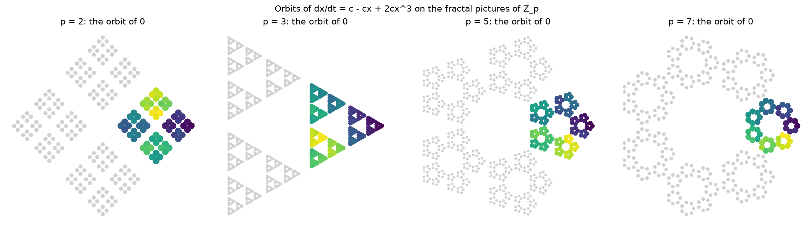
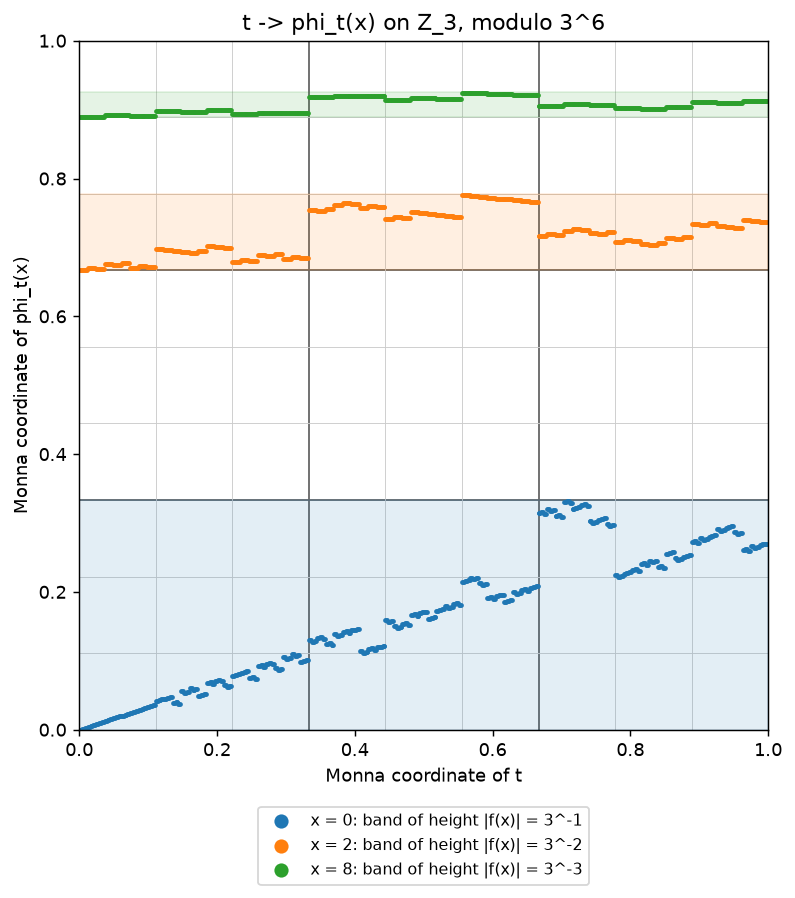

# Дифференциальные уравнения, которые решаются без погрешности: p-адические потоки на GPU

Численное решение дифференциального уравнения — это всегда приближение. Каждый шаг метода Рунге — Кутты вносит ошибку, ошибки копятся, и через достаточно большое время от решения остаётся только качественная картина.

Есть числовая система, где этого не происходит: p-адические числа. Там решение уравнения `dx/dt = f(x)` с точностью «K цифр» — конечный объект, который вычисляется в целых числах без единого округления, сразу для всех начальных точек и всех моментов времени. Я написал библиотеку на JAX, которая это делает, и ниже расскажу, как она устроена и зачем это может пригодиться человеку, далёкому от теории чисел: например, чтобы за одно и то же время получить миллионный и 10³⁰-й член нелинейного генератора псевдослучайных чисел.



*По одной орбите уравнения для каждого простого p. Каждая орбита — целый «кластер», то есть шар.*

<cut />

## p-адические числа за две минуты

Обычное вещественное число — это запись, бесконечная вправо: `3,14159…`. Целое p-адическое число — запись в системе счисления по основанию `p`, бесконечная **влево**: `…a₃a₂a₁a₀`. Складывают и умножают их столбиком, как обычные числа, перенос уходит влево.

Два таких числа близки, если у них совпадает много **младших** цифр. Расстояние равно `p^(−k)`, где `k` — число совпавших цифр. Отсюда главное для программиста:

- «знать число с точностью K цифр» значит знать его остаток по модулю `p^K`;
- сложение и умножение по модулю `p^K` — это **точные** операции над приближениями: младшие K цифр результата зависят только от младших K цифр аргументов. Ошибка не растёт вообще.

Множество всех таких чисел обозначается `Z_p`. Шар в нём — это все числа с заданными младшими цифрами, то есть класс вычетов `a + p^k·Z_p`.

## Почему уравнение решается точно

Возьмём уравнение `dx/dt = f(x)`, где `x` — p-адическое, `f` — многочлен. Формальное решение даёт ряд Ли:

```
φ_t(x) = x + t·f(x) + t²/2!·(f·f')(x) + … = Σ tⁿ/n! · Dⁿx,   D = f·d/dx
```

Над вещественными числами `n!` в знаменателе помогает сходимости. Над p-адическими — мешает: `n!` делится на высокую степень `p`, а деление на `p` число **увеличивает**. Но если все коэффициенты `f` делятся на `p`, то каждое применение `D` добавляет множитель `p`, и он выигрывает у факториала. Получается три факта:

1. Ряд сходится при всех `x` и **всех p-адических `t`**. Поток существует глобально.
2. По модулю `p^K` в ряду остаётся конечное число членов, так что `φ_t(x) mod p^K` — многочлен от `(t, x)` с целыми коэффициентами.
3. Значит, «решение с точностью K цифр» — конечная таблица коэффициентов. Посчитали её один раз — и дальше каждый запрос независим и точен.

Время здесь тоже p-адическое, и это не прихоть: непрерывный путь из вещественной прямой в `Z_p` обязан быть константой, потому что прямая связна, а `Z_p` рассыпается в пыль. У p-адического времени нет порядка «раньше — позже», зато целые моменты `t = 0, 1, 2, …` в нём есть, и к ним мы ещё вернёмся.

## Первый пример

```python
import jax
import numpy as np
import galrax.padic as pf

jax.config.update("jax_enable_x64", True)

# dx/dt = 3(x³ − x) над Z_3, 19 троичных цифр
flow = pf.PAdicFlow(p=3, precision=19, field=[0, -3, 0, 3])

x = np.array([0, 1, 2, 5])
y = flow.flow(t=12345, x=x)                      # φ_t(x) mod 3^19, точно
print(np.array_equal(flow.flow(-12345, y), x))   # True: назад тем же путём

print(flow.orbit_level(x))                       # [19 19  2  2]
```

Вторая проверка — то, чего у обычного решателя не бывает: интегрируем вперёд на 12345, потом назад на 12345 и получаем исходные числа **бит в бит**.

Последняя строка — про геометрию. Точки `0` и `1` — положения равновесия. А орбиты точек `2` и `5` имеют «уровень 2»: это шары радиуса `3^(−2)`.

## Орбиты — это шары

Над вещественными числами траектория — кривая. Здесь всё иначе. Если `f(x) ≠ 0`, то для любых моментов `s`, `t`

```
|φ_t(x) − φ_s(x)| = |f(x)| · |t − s|
```

Движение идёт с постоянной скоростью `|f(x)|`, причём точно, а не в первом приближении. В размерности один отсюда следует, что орбита точки — это **весь шар** радиуса `|f(x)|` вокруг неё (для отображения за единицу времени это недавно доказал Ф. Мухамедов другим способом; у меня доказательство идёт от поля и даёт метрическое тождество в любой размерности).



*`t ↦ φ_t(x)` для p = 3. Числа из Z_3 нарисованы на отрезке: шары становятся интервалами. Каждая орбита заполняет полосу высотой ровно `|f(x)|`.*

Практическое следствие: у потока есть «выпрямляющая координата» — время, за которое из `x` попадают в `y`. Она считается методом Ньютона, который на каждом шаге удваивает число верных цифр:

```python
time, on_orbit = flow.orbit_time(2, y[2])
print(int(time) % 3**17, on_orbit)               # 12345 True

print(flow.first_hitting_time(2, 29, level=4))   # 6: первое n, при котором φ_n(2) ≡ 29 mod 3⁴
print(flow.return_time(2, level=10))             # 6561 = 3⁸
```

Время возврата, время первого попадания, среднее вдоль орбиты — всё это получается по формуле, без прогона траектории.

## Как это считается быстро

Многочлен из пункта 2 выше честный, но большой: для 19 цифр по основанию 3 в нём 36 членов по `t` и степень 33 по `x`. Вычислять его в лоб — около тысячи умножений на точку.

Дальше работает приём, которым в libm считают `exp`: аргумент делят на табличную часть и маленький остаток.

- **По времени.** `t = t_lo + σ`, где `t_lo` — три младшие цифры, а `σ` делится на `p³`. Для 27 значений `t_lo` многочлены сведены в таблицу, а для «p-адически малого» `σ` ряд укорачивается с 36 членов до 6.
- **По пространству.** `x = a + p^r·y`, где `a` — младшие `r` цифр. В разложении вокруг центра `a` член степени `k` получает множитель `p^(rk)` и по модулю `p^K` исчезает при `rk ≥ K`. Степень падает с 33 до **2**.

Отличие от `exp` в libm одно: там оба куска приближённые, здесь оба точные. Итог на ноутбучной видеокарте — около **2·10⁸ точных значений потока в секунду**, и разные способы вычисления сходятся бит в бит.

Из неочевидного: решает не арифметика, а память. Если сначала собрать для каждой точки её строку таблицы (`gather` на всю строку), получается массив в сотни мегабайт, и «ускоренная» версия работает медленнее исходной. Нужно читать по одному коэффициенту на шаг схемы Горнера. Таблицы размером 0,5–10 МБ оптимальны, дальше они выпадают из кэша.

Точность не ограничена машинным словом: за пределами 62 бит включается арифметика на двух словах и на лимбах (100 троичных цифр — около полумиллиона значений в секунду).

## Что с этим делать программисту

Самое неожиданное применение — к обычным целочисленным циклам. Связь такая: если многочлен `T` после нескольких итераций становится тождественным по модулю `p`, то его итерации продолжаются до потока (это теорема Белла — Пунена). А у потока, как мы видели, n-й момент времени считается многочленом от `n`.

**Jump-ahead для нелинейного генератора.** Для линейного конгруэнтного генератора формула n-го члена известна всем. Для квадратичного `x ← 2x² + 3x + 1 mod 2⁶⁴` — уже нет. Здесь она получается автоматически:

```python
qcg = pf.PAdicMap(2, [1, 3, 2])          # x -> 2x² + 3x + 1
y = qcg.iterate(0, 10**30, 64)           # 10³⁰-й член, стоит столько же, сколько сотый
print(qcg.index(0, y, 64) == 10**30 % 2**64)   # True: номер члена по его значению
print(qcg.iterate(qcg(12345, 64), -1, 64))     # 12345: n = −1 даёт обратное отображение
```

Вторая строка — обратная сторона медали: по значению восстанавливается его номер в последовательности. Такой генератор предсказуем, и строить на нём криптографию нельзя. (Для генераторов с побитовыми операциями, вроде T-функций Климова — Шамира, метод не работает: ему нужна аналитичность.)

**Цикл, который никогда не достигнет значения.** Множество моментов, когда цикл попадает в заданное условие, находится целиком:

```python
loop = pf.PAdicMap(11, [1, -3])          # x <- 1 − 3x, старт с x = 1
print(bool(loop.hitting_times(1, pf.PAdicEvent([-100, 1], 2), 3)))   # False
```

Пустое множество по модулю `11³` — это доказательство: над целыми числами цикл не примет значение 100 никогда, потому что иначе он принял бы его и по модулю.

**Номер члена рекуррентной последовательности.** Многочлены Чебышёва, последовательности Люка и Диксона — степени матрицы 2×2, и степень восстанавливается по значению:

```python
def chebyshev(n, x, m):                  # T_n(x) mod m рекуррентой T_{n+1} = 2x·T_n − T_{n−1}
    a, b = 1, x % m
    for _ in range(n):
        a, b = b, (2 * x * b - a) % m
    return a

p, k, x, n = 7, 10, 3, 123456
target = chebyshev(n, x, p**k)           # T_n(3) mod 7¹⁰
print(pf.matrix_power_index(p, k, [[0, 1], [-1, 2 * x]], (1, x), target))   # 123456
```

Это «дискретный логарифм» для обмена ключами на многочленах Чебышёва над `Z/p^k`. Для модуля `2^w` такие схемы взломаны давно и другими людьми; здесь тот же эффект получается единым методом для любого `p`.

**Нули линейных рекуррент.** Классический тест — последовательность Берстеля `a(n+3) = 2a(n+2) − 4a(n+1) + 4a(n)` с началом `0, 0, 1`:

```python
zeros = pf.recurrence_times(3, 10, [4, -4, 2], (0, 0, 1))
print([ball.center[0] for ball in zeros.balls])   # [0, 1, 4, 6, 13, 52]
```

Шесть кандидатов — и это ровно шесть известных нулей этой последовательности. То же работает для нелинейных отображений в нескольких переменных, где готовых инструментов я не нашёл.

## Нормальные формы с сертификатом

Около положения равновесия поле хочется упростить заменой координат — это нормальная форма Пуанкаре — Дюлака. Классическая беда — малые знаменатели: каждый шаг делит на число, которое может оказаться очень маленьким, и сходимость требует диофантовых условий.

Над `Z_p` знаменатель «мал», когда он делится на высокую степень `p`, и это видно из формы Смита гомологического оператора — без вычисления собственных значений. Правило простое: если деление стоит больше заданного числа цифр, не делим, а оставляем член в нормальной форме. Сходимость тогда есть всегда, на явном шаре. А к ответу прилагается сертификат — конечный набор сравнений, проверяемый в целых числах:

```python
# x' = 3x + 3y², y' = 6y + 3x² + 3xy: резонанс 2·3 = 6 оставляет x² во втором уравнении
resonant = pf.PAdicFlow(3, 8, [{(1, 0): 3, (0, 2): 3}, {(0, 1): 6, (2, 0): 3, (1, 1): 3}])
form = resonant.normal_form((0, 0))
print(form.resonant_terms, form.radius)   # [{}, {(2, 0): 27}] 2
print(form.certificate.verify())          # True
```

`True` означает: поток, посчитанный через нормальную форму, совпадает с настоящим по модулю `3⁸` на всём шаре.

## Что здесь известно, а что новое

Чтобы не вводить в заблуждение:

- **Известно.** Сам ряд Ли; интерполяция итераций (Малер, Белл, Пунен); эргодическая теория отображений `Z_p` (Анашин, Хренников, Фан, Ляо); то, что одномерные орбиты — шары.
- **Насколько я смог проверить, новое.** Метрическое тождество в любой размерности; точное описание отображений, которые являются сдвигами потока за единицу времени; критерий минимальности действия группы на шаре произвольного радиуса; сертифицированные нормальные формы через форму Смита; и вся вычислительная часть — точные глобальные потоки в машинных целых, таблицы, координаты потокового ящика методом Ньютона.

Три препринта с доказательствами готовятся к выкладке на arXiv.

## Ограничения

- Коэффициенты поля должны делиться на `p` (на 4 при `p = 2`). Любое поле с целыми p-адическими коэффициентами приводится к этому заменой масштаба времени.
- Табличный метод требует `p^(r·d)` центров, поэтому в больших размерностях выигрыш меньше; тесты доходят до `d = 4`.
- Подготовка jump-ahead медленная при больших `p`.
- На Windows JAX видит GPU только из-под WSL2.

## Ссылки

- Код: [github.com/NotTruecCoder/galrax](https://github.com/NotTruecCoder/galrax)
- Установка: `pip install git+https://github.com/NotTruecCoder/galrax.git`

Буду благодарен за замечания — и по математике, и по коду. Особенно интересно, пригодится ли кому-нибудь jump-ahead для нелинейных генераторов и анализ циклов по модулю `2⁶⁴` на практике.
